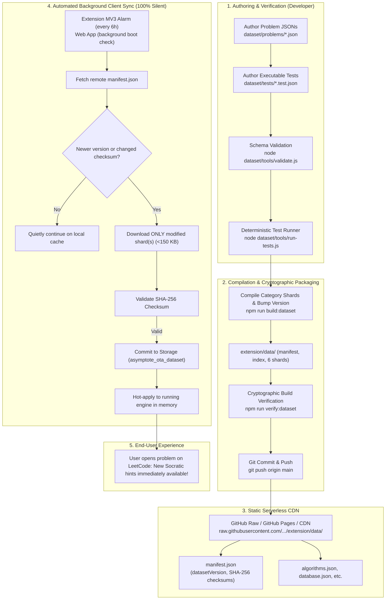

# Asymptote Dataset Release & OTA Distribution Workflow

This guide details the complete authoring, verification, compilation, and automated Over-The-Air (OTA) distribution workflow for the **Asymptote** dataset.

Asymptote is designed to expand batch by batch from its baseline of 105 curated problems toward **1,000+ curated problems** across all 6 domains (*Algorithms*, *Database*, *pandas*, *Shell*, *Concurrency*, *JavaScript*). 

With Asymptote's serverless distribution architecture, whenever you commit and push new problem batches to GitHub, **all active extension and dashboard users worldwide automatically receive the new problem hints, test suites, and multi-language solutions silently in the background within 6 hours**—with zero Google Chrome Web Store review delays, zero user prompts, and zero UI interruptions.

---

## 1. System Architecture



---

## 2. Directory Structure & Key Files

| Path | Purpose |
| :--- | :--- |
| `dataset/patterns/*.json` | The 99 patterns defined across all 6 domains, with mental triggers, constraint signals, complexity, and starter templates. |
| `dataset/problems/*.json` | Curated problem definitions with 4-level Socratic hints, multi-language solutions, and complexity targets. |
| `dataset/tests/*` | Executable test cases (C++, Python 3, JavaScript, MySQL schemas, pandas fixtures, Shell input cases). |
| `dataset/catalog/leetcode-catalog.json` | Complete index of 4,086 LeetCode problems with pattern classification tags. |
| `dataset/tools/build.js` | Shard compiler that generates `extension/data/` files and SHA-256 checksums. |
| `dataset/tools/validate.js` | Strict schema and taxonomy validator. |
| `dataset/tools/run-tests.js` | Deterministic test runner across language runtimes. |
| `scripts/verify-dataset-build.js` | Validates compiled distribution shards, manifest checksums, and cross-references. |
| `extension/data/` | Built distribution shards bundled inside the extension and served statically for OTA updates. |

---

## 3. Step-by-Step Batch Authoring Workflow

When authoring a new batch of curated problems (e.g., Batch 6, Batch 7, etc.):

### Step 1: Select Candidate Problems
Inspect `dataset/catalog/leetcode-catalog.json` or target pedagogical high-yield patterns (e.g. dynamic programming, sliding window, graph traversals, SQL joins).

### Step 2: Create Problem JSON Files
Add a new JSON file in `dataset/problems/<slug>.json` adhering to the canonical schema:
```json
{
  "slug": "problem-slug",
  "number": 123,
  "category": "Algorithms",
  "patterns": ["sliding-window-variable"],
  "hints": [
    { "level": 1, "title": "Observation / Invariant", "text": "Level 1 Socratic question..." },
    { "level": 2, "title": "State Definition / Structural Choice", "text": "Level 2 structural clue..." },
    { "level": 3, "title": "Transition / Algorithmic Pivot", "text": "Level 3 step-by-step logic..." },
    { "level": 4, "title": "Complete Implementation", "text": "```python\n# Clean Python solution\n```" }
  ],
  "complexity": {
    "kind": "big-o",
    "time": "O(N)",
    "space": "O(1)",
    "variables": ["N: length of input array"],
    "notes": "Single-pass two-pointer window scan."
  },
  "solutions": [
    {
      "lang": "python3",
      "code": "class Solution:\n    def solve(self, nums: list[int]) -> int:\n        pass",
      "approach": "Sliding Window",
      "verifiedBy": "tests",
      "testedOn": "2026-10-20"
    },
    {
      "lang": "cpp",
      "code": "class Solution {\npublic:\n    int solve(vector<int>& nums) {\n        return 0;\n    }\n};",
      "approach": "Sliding Window",
      "verifiedBy": "tests",
      "testedOn": "2026-10-20"
    }
  ],
  "review": { "status": "tested" },
  "updated": "2026-10-20T00:00:00.000Z"
}
```

### Step 3: Add Executable Tests (Optional for Standard Algo, Required for DB/Pandas)
Create `dataset/tests/<slug>.test.json` containing test cases with input arguments and expected outputs.

### Step 4: Validate Taxonomy & Schemas
Run the automated validator:
```bash
node dataset/tools/validate.js
```
Guarantees:
- Valid JSON schema.
- All pattern IDs exist in `dataset/patterns/`.
- Hints follow the 4-level progressive structure.
- Complexity declarations include target time and space.

### Step 5: Run Deterministic Solution Tests
Execute the problem test runner to verify solutions against all test cases:
```bash
node dataset/tools/run-tests.js
```

### Step 6: Compile Shards & Bump Dataset Version
Run the build tool to shard problems by category and update cryptographic checksums:
```bash
# Auto-increments patch version (e.g. 1.0.0 -> 1.0.1)
node dataset/tools/build.js --bump

# Or specify an explicit version:
node dataset/tools/build.js --dataset-version=1.1.0
```
This updates:
- `dataset/version.json`
- `extension/data/manifest.json` (with fresh SHA-256 checksums)
- `extension/data/algorithms.json` (and other category shards)
- `extension/data/index.json`

### Step 7: Verify Distribution Artifacts
Run the distribution verification script:
```bash
npm run verify:dataset
```
This asserts:
- All 8 distribution files exist.
- All SHA-256 hashes match `manifest.json` bit-for-bit.
- All curated problems and patterns are cross-referenced with zero dangling IDs.

### Step 8: Run Complete Test Suite & Package
```bash
npm run check-shared
npm test
npm run lint
npm run package:extension
```

### Step 9: Commit & Release
Commit the new problem files and updated `extension/data/` shards:
```bash
git add dataset/ extension/data/
git commit -m "feat(dataset): Release Batch X curated problems (v1.0.1)"
```
Once pushed to `main`, the updated shards become available at `https://raw.githubusercontent.com/RijulSitpure/LeetCode-Pattern_Tracker/main/extension/data/`.

---

## 4. How Active Clients Auto-Sync (Over-The-Air)

1. **Scheduled Polling**:
   - **Chrome Extension**: Uses `chrome.alarms` (`asymptote_silent_dataset_sync`) triggering every 6 hours, plus checks on browser startup and extension install.
   - **Web App**: Non-blocking background check runs 1.5 seconds after initial boot.
2. **Bandwidth Optimization**:
   - Compares remote `manifest.json` checksums against local baseline.
   - Downloads **only** the modified shard(s) (typically 50 KB – 150 KB). Unmodified shards are never re-downloaded.
3. **Cryptographic Tamper Protection**:
   - Downloads are digested via `crypto.subtle.digest('SHA-256')`.
   - Any shard failing hash verification is rejected immediately.
4. **Transparent Hot-Reloading**:
   - Verified shards are stored in `asymptote_ota_dataset` (`chrome.storage.local` in extension, `localStorage` in web app).
   - In-memory problem maps are updated in real time via `engine.applyOtaDataset(otaData)`.
   - The user never sees loading spinners, dialogs, or page reloads.

---

## 5. Offline User Progress Backup & Restore

All user progress (solved problems, custom notes, confidence ratings, and review queue) is stored locally in client storage. To protect user data across device migrations or browser reinstalls:
- **1-Click Export**: Click **"Export Backup (.json)"** in the dashboard Sync modal or extension popup to download `asymptote-backup-YYYY-MM-DD.json`.
- **1-Click Restore**: Click **"Import Backup (.json)"** to merge or restore progress with instant hot-reload.
- **Unit Tested**: Round-trip backup integrity is tested in `tests/user-data-backup.test.js`.
